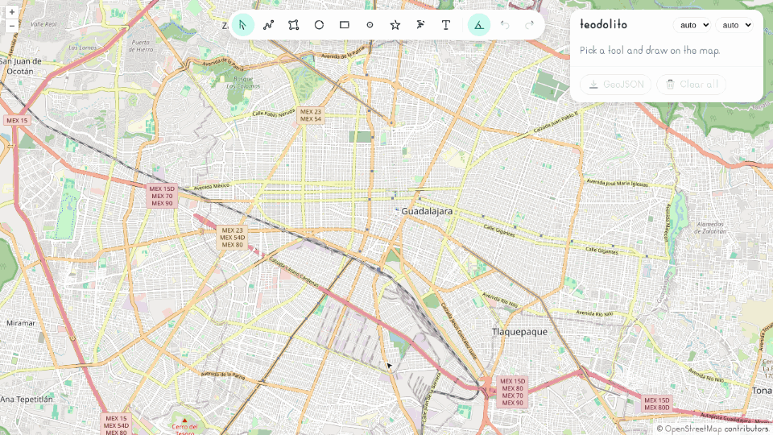

# <picture><source media="(prefers-color-scheme: dark)" srcset=".github/assets/icon-dark.svg"></picture> teodolito

[](https://www.npmjs.com/package/teodolito)
[](https://bundlejs.com/?q=teodolito)
[](LICENSE)

Headless measuring and drawing tools for OpenLayers: geodesic measures, vertex editing, undo/redo and GeoJSON.



**[Live demo](https://ghegar.github.io/teodolito/)**

teodolito owns the state — tools, geodesic measures, selection, vertex editing, undo/redo, text editing,
GeoJSON — and you own every pixel: it ships no styles, only the measure and state of each feature for
your own style function, plus a snapshot to render your toolbar and list from. It ships no elevation
data either: profiles and terrain come from a provider you inject.

## Install

```bash
npm install teodolito ol
```

| Entry | What it is | Needs |
|---|---|---|
| `teodolito` | Framework-free core: tools, measures, editing, history, handles, GeoJSON, elevation profiles and terrain-RGB | `ol >= 10` |
| `teodolito/react` | `TeodolitoProvider`, `useTeodolito`, `useMeasurement`, `useTextEditor`, `useProfile` and `useElevation` | `react >= 19` |

## Quick start

```ts
import { Stroke, Style, Text } from 'ol/style.js';
import { createTeodolito } from 'teodolito';

const teodolito = createTeodolito(map, {
    locale: 'en-US',
    style: (feature, { label, selected, sketch }) => new Style({
        stroke: new Stroke({ color: '#0f766e', width: selected ? 4 : 2, lineDash: sketch ? [8, 6] : undefined }),
        text: new Text({ text: label }),
    }),
});

teodolito.setTool('polygon');
teodolito.subscribe(() => render(teodolito.getSnapshot().items.map((item) => teodolito.format(item.measure))));
document.querySelector('#undo')?.addEventListener('click', () => teodolito.undo());
```

## Features

| Feature | API |
|---|---|
| Tools: line, polygon, angle, circle, rectangle, point, symbol, freehand, text | `setTool(tool \| null)`, `once`, `circleSides` options |
| Geodesic measures (length, area, perimeter, lon/lat) | `item.measure`, `measureGeometry()` |
| Per-segment length and bearing, vertex angles | `measure.segments`, `measure.angles` |
| Segment lengths, vertex angles and start/end markers on the map | `marks`, `setMarks()`, `markStyle`, `createMarkStyle()` |
| Circle center and radius, rectangle width and height | `measure.shape` |
| Metric and imperial units with `Intl`: m/km/ft/mi and m²/ha/km²/ft²/ac/mi² | `units` option, `setUnits()`, `format()`, `formatMeasure()` |
| Live measure while drawing | `snapshot.drawing`, `snapshot.sketch` |
| Select, move (Translate), edit vertices (Modify), snap | click on the map, `select(id)`, `snap` option |
| Measures follow edits | recomputed on every geometry change |
| Undo/redo of add, remove, clear, move, vertex edits, text, props | `undo()`, `redo()`, `canUndo`, `canRedo` |
| Text as state: you render the input | `editingTextId`, `commitText()`, `cancelText()` |
| Your own style props per item | `defaultProps`, `setProps(id, patch)` |
| Names and visibility | `rename(id, name)`, `item.name`, `setVisible(id, visible)` |
| Rotate and scale anything, circle radius | `rotate()`, `scale()`, `setTransform()`, `setRadius()` |
| On-map handles for the selection | `handles`, `handleStyle`, `context.handle` |
| GeoJSON in EPSG:4326 | `toGeoJSON()`, `fromGeoJSON()` |
| Keyboard: Esc, Ctrl+Z, Ctrl+Shift+Z/Ctrl+Y, Delete | `keyboard: false` to opt out, `escape()` to wire your own stack |
| Events | `onEvent({ type, ... })` |

### Units

`units` (option, `setUnits()` or `FormatOptions.units`) takes `length`, `area` and `system`.
`system` is `metric` (default), `imperial` or `auto`; `auto` picks imperial when the region of
`locale`, or of `navigator.language` without it, is US, LR or MM (`en-US` and `en` are imperial,
`en-GB` is metric). With `length` or `area` set to `auto` the unit scales inside the system: m below
1 km, then km; ft below 1 mi, then mi; m², ha, km²; ft² below 1 acre, ac below 1 mi², then mi². A
fixed unit (`m`, `km`, `ft`, `mi`, `m2`, `ha`, `km2`, `ft2`, `ac`, `mi2`) wins over the system.
`formatElevation` uses ft in imperial. `resolveUnitSystem()` and `localeSystem()` expose the choice.

```ts
createTeodolito(map, { locale: navigator.language, units: { system: 'auto' } });
formatLength(1609.344, { units: { system: 'imperial' }, locale: 'en-US' }).text;
```

## Tools and measures

Circles are geodesic polygons built from a center and a radius in meters; rectangles are axis-aligned
boxes from two corners. Both are stored as `Polygon`, so they measure, serialize and take elevation
like any polygon; see below to rotate, scale and resize them.

Lines, polygons and rectangles carry `segments` (`length`, geodesic `bearing` 0–360°, `midpoint` in the
map projection) and `angles` (`vertex`, `degrees`, `coordinate`): interior angles for polygons whatever
the ring winding, the angle between both segments for lines. Freehand strokes and circles leave them
empty. `formatAngle()` and `formatBearing(deg, { style: 'quadrant' })` (`N 45° E`) format them.

The `angle` tool takes three clicks (arm, vertex, arm) and measures `{ kind: 'angle', degrees }`, the
angle between both arms (0–180°); its vertices can be dragged but not added or removed.

## Marks on the map

```ts
import { createMarkStyle, createTeodolito } from 'teodolito';

const teodolito = createTeodolito(map, {
    style,
    marks: { segmentLabels: true, vertexAngles: true, vertices: true },
    markStyle: createMarkStyle({ font: '11px sans-serif', endpointRadius: 6 }),
});
teodolito.setMarks({ vertexAngles: false });
```

Marks are drawn on teodolito's layer after your style, for items and for the sketch. All are off by
default. `segmentLabels` puts each segment's length on its midpoint, `vertexAngles` the interior angle
on each vertex, and `vertices` marks the start, the end (lines only) and the vertices in between; freehand
strokes only get start and end, circles none. Labels use the instance `units`, `locale` and `format`
(imperial included) and `angleDigits` (0). `angleAt: 'last'` keeps only the angle of the last corner
drawn instead of one per vertex (`'every'`, the default). A segment shorter than `minSegmentPixels` (40) on screen hides
its label and the angles it touches. `snapshot.marks` holds the current switches.

`markStyle(mark, context)` returns OpenLayers styles for one `Mark` (`type`: `segment`, `angle`, `start`,
`end` or `vertex`; `index`, `coordinate`, `value`, `label`); styles without a geometry are placed on
`mark.coordinate`. The default, `createMarkStyle()`, draws a filled start, a double-ring end and hollow
vertices in `props.color` (or OpenLayers blue) and plain text labels; every color, radius, font and
offset is an option.

## Symbols, rotation and scale

`setTool('symbol')` places points that carry `snapshot.symbol` (`setSymbol('🌳')`). The symbol is an
opaque string — an emoji, an icon id — and your style function draws it; teodolito ships no catalog.

`rotate(id, radians)` and `scale(id, factor)` work on every kind. Lines, polygons and rectangles are
transformed around their center (or `anchor`) and their measure follows; circles do not rotate and
scale by regenerating a geodesic circle (`setRadius(id, meters)` too). Text and symbols keep the
geometry and change `item.rotation` and `item.scale` instead, which reach your style; `scale` is clamped
to `scaleLimits` (`[0.25, 4]`). Rotation is clockwise everywhere, like bearings and OpenLayers styles.

With `handles` on (the default) the selection gets handle points your style function draws when
`context.handle` is `'rotate'`, `'scale'`, `'radius'` or `'corner'` (or pass `handleStyle`). Dragging a
handle updates live and lands as a single undo step. Rectangle corners resize in the rectangle's own
frame, so a rotated rectangle stays a rectangle.

## Editing and history

With no tool active, a click selects a feature: `Translate` moves it, `Modify` edits its vertices and
`Snap` (on by default) snaps to the others. Measures are recomputed on every geometry change. Every add,
remove, clear, move, vertex edit, text and props change is one undo step; the stack keeps the last
`historyLimit` (100).

Escape unwinds one step at a time: abort the sketch, cancel the text, clear the selection, drop the tool.
While drawing, Ctrl+Z and Delete remove the last vertex.

### Sharing the map with other tools

```ts
createTeodolito(map, { arbiter, tool: 'measure', keyboard: false, zIndex: 950 });
```

`arbiter` is anything with `claim(tool, { escape }) => release`. Activating a tool claims the click
under `tool` (default `'measure'`), so other tools stop selecting while you measure; dropping the tool
or `destroy()` releases it. When the arbiter takes the click away (Escape from its stack, or another
tool claims it), teodolito runs `escape()` and drops the tool. Pass `keyboard: false` when the arbiter
already owns Escape.

The layer sits at `zIndex` 1000 and its handles one above. Hosts that reserve the 900–999 band for
tools pass a value in it, such as `zIndex: 950`.

## Style context

Your style function gets `(feature, context)`:

| Field | Meaning |
|---|---|
| `kind` | `line`, `polygon`, `angle`, `circle`, `rectangle`, `point`, `symbol`, `freehand` or `text` |
| `measure`, `label` | the raw measure and its formatted text (the text itself for `text`) |
| `name`, `text`, `props` | the item's name, its text and your own props |
| `selected`, `editing` | selection and text editing state |
| `symbol`, `rotation`, `scale` | the item's symbol and its clockwise rotation (radians) and scale |
| `handle` | set on handle points: `rotate`, `scale`, `radius` or `corner`; `null` otherwise |
| `sketch`, `vertex` | the feature belongs to the drawing in progress; `vertex` is the sketch cursor point |
| `resolution` | the map resolution |

Without a style function teodolito falls back to OpenLayers' default styles.

## Elevation

### Profile

teodolito samples a line and asks your `ElevationProvider` for the heights; it ships no DEM.

```ts
import { computeProfile, type ElevationProvider } from 'teodolito';

const provider: ElevationProvider = {
    maxPoints: 200,
    async getElevations(points, { signal }) {
        const response = await fetch('/elevation', { method: 'POST', body: JSON.stringify(points), signal });
        return response.json();
    },
};

const profile = await computeProfile(lineString, provider, { projection: 'EPSG:3857' });
profile.points;
profile.ascent;
```

| Piece | What it does |
|---|---|
| `sampleLine(lonLats, { step, maxSamples })` | samples along great circles, always keeping the vertices; never more than `maxSamples` (512) |
| `ElevationProvider` | `getElevations(points, { signal })` returns one height or `null` per point; `maxPoints` splits the request in batches |
| `buildProfile(samples, elevations)` | distance against elevation plus `length`, `surfaceLength`, `ascent`, `descent`, `netChange`, `max`, `min`, `missing` |
| `computeProfile(lineString, provider, options)` | all of the above for a projected `LineString`, abortable with `signal` |
| `formatElevation(meters, { locale, units })` | `1,523 m`, or `4,997 ft` in imperial |

Missing heights stay as `null` in `points`; the statistics bridge the gaps between known heights.
Profiles cover lines and freehand strokes.

### Areas and points

| Piece | What it does |
|---|---|
| `computeSurface(polygon, provider, { cells, hypsometrySteps })` | samples a `cells × cells` grid over the polygon (holes respected) plus its vertices: `planarArea`, `surfaceArea`, `min`, `max`, `mean`, `hypsometry`, `samples`, `missing` |
| `getPointElevation(point, provider)` | the height of one point, or `null` |
| `computeElevation(geometry, provider, options)` | `{ kind: 'point' \| 'profile' \| 'surface', ... }` by geometry type |

`surfaceArea` scales the exact geodesic area by the ratio between the 3D and flat area of the grid
cells, so it always agrees with `measure.area` on flat ground. `hypsometry[i].share` is the fraction of
the area above `hypsometry[i].elevation`.

### Terrain-RGB tiles

```ts
import { cachedElevation, createTerrainRgbProvider } from 'teodolito';

const provider = cachedElevation(createTerrainRgbProvider({
    url: 'https://s3.amazonaws.com/elevation-tiles-prod/terrarium/{z}/{x}/{y}.png',
    zoom: 12,
    encoding: 'terrarium',
    interpolate: true,
}));
```

`encoding` is `'mapbox'`, `'terrarium'` or your own `(r, g, b, a) => number | null`. Each tile is fetched
once and kept in a bounded cache (`maxTiles`, 64); an aborted request never poisons it. Tiles are decoded
with `createImageBitmap` and a canvas created with `willReadFrequently` on first use, so the browser keeps
the pixels on the CPU and stays quiet; pass `decode` to run elsewhere, `fetch` to add headers.

## React

```tsx
import { TeodolitoProvider, useCreateTeodolito, useTeodolito, useTextEditor } from 'teodolito/react';

const teodolito = useCreateTeodolito(map, { style });

<TeodolitoProvider value={teodolito}>
    <Toolbar />
</TeodolitoProvider>

function Toolbar() {
    const { tool, setTool, items, canUndo, undo, format } = useTeodolito();
    ...
}
```

A floating list of measurements needs nothing else: `items` (each with `id`, `kind`, `name`, `measure`,
`visible`), `selectedId`, `select`, `rename`, `setVisible`, `remove`, `clear`, `undo`/`redo` with
`canUndo`/`canRedo`, `format(item.measure)`, `toGeoJSON()`, and `marks`/`setMarks` for the label switches.
Names travel as `properties.name` in GeoJSON; renaming is one undo step, hiding is not recorded.

`useMeasurement(id)` reads one item and keeps its reference while it does not change. `useTextEditor()`
returns the text being edited with its map coordinate, `commit` and `cancel`.

```tsx
const { status, profile, error, refresh } = useProfile(selectedId, provider, { debounce: 250 });
```

`useElevation(id, provider, options)` does the same for points, lines and polygons and returns
`{ status, elevation, error, refresh }`; `kinds` narrows the geometries it accepts.

`useProfile` follows the item's geometry: edits, undo and redo recompute it after the debounce and abort
the previous request. While loading it keeps the last profile of the same item. Keep `provider` stable.

## Known limitations

- Rectangles are drawn axis-aligned from two corners; rotate them afterwards.
- Circles are stored as polygons of `circleSides` sides, so their area is slightly below πr².
- No elevation data is bundled: profiles and terrain need your `ElevationProvider` or terrain-RGB tiles.
  Tiles are read with `fetch`, so the server must allow CORS.
- `surfaceArea` and the hypsometry come from a `cells × cells` grid, not from the full DEM resolution.

## Development

```bash
npm test
npm run lint
npm run typecheck
npm run demo
npm run e2e
```

The demo is an OpenStreetMap map with every tool, units, segment and angle marks, a list of items with
names, colors, visibility, rotate and scale, GeoJSON download, text editing on the map and an elevation panel
fed by a synthetic provider or Terrarium tiles. The e2e suite runs Playwright against it.

## Contributing

Issues are welcome. Open one before sending a pull request.

## License

AGPL-3.0-only © GHEgar
